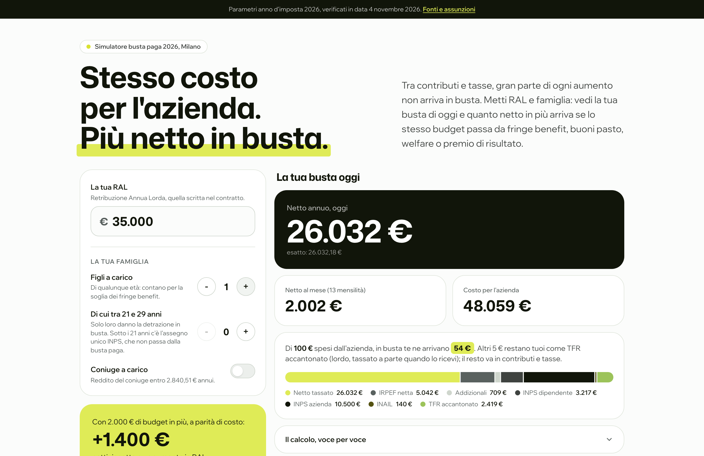
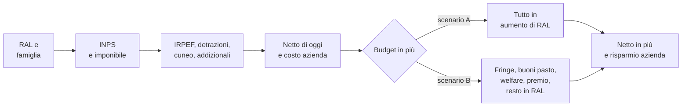
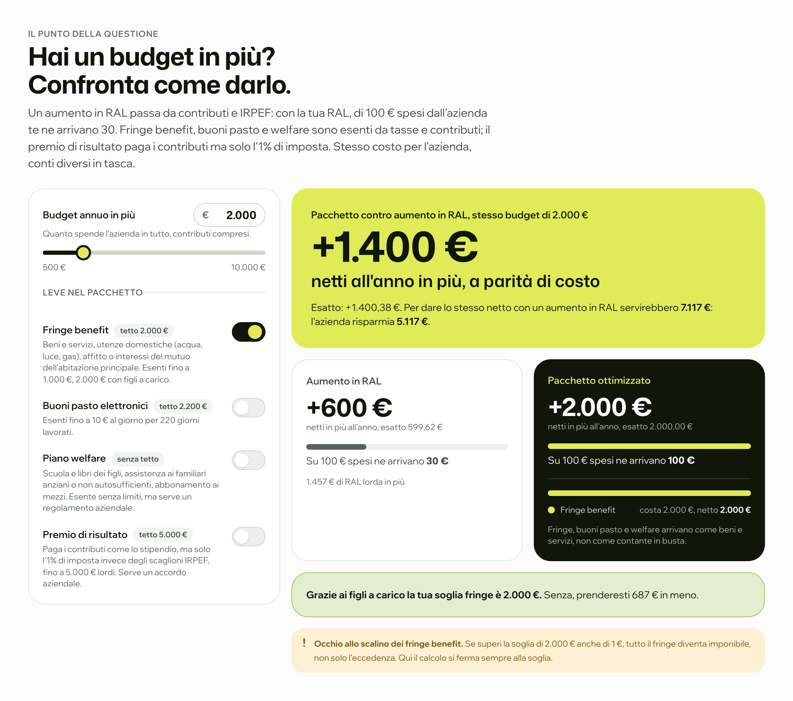
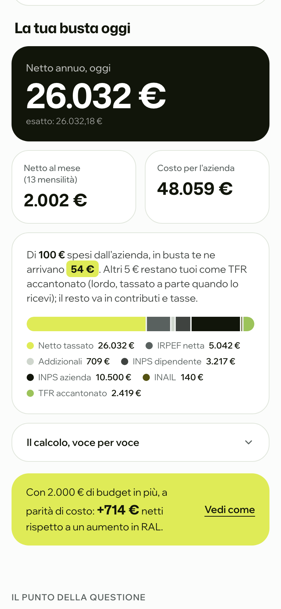

<div align="center">

# Calcolatore RAL

**Stesso costo per l'azienda, più netto in busta.**

Dalla RAL al netto 2026, al costo azienda e al modo più conveniente di dare un aumento.

[](https://calcolatore-ral.vercel.app)


> **È una stima: non sostituisce la busta paga reale.** Regole fiscali 2026 per un dipendente residente a Milano.

[**Prova la demo**](https://calcolatore-ral.vercel.app) &nbsp;&nbsp; nessuna registrazione, la RAL non lascia il browser

<br>



</div>

## Il problema

Di 100 euro di aumento pagati dall'azienda, a un dipendente con RAL 35.000 ne arrivano in busta circa 30: il resto va in contributi e tasse. Esistono però strade esenti o quasi, come fringe benefit, buoni pasto, welfare e premio di risultato, che con lo stesso costo lasciano molto più netto. Quali convengano, e quanto, dipende dalla RAL e dalla famiglia.

**Il calcolatore risponde a una domanda: a parità di costo per l'azienda, quanto netto in più può arrivare al dipendente?**

Esempio, RAL 35.000 e budget 2.000 euro con un figlio a carico: l'aumento in RAL lascia circa 600 euro netti, il fringe benefit ne lascia 2.000. Per dare lo stesso netto con un aumento servirebbero 7.117 euro: l'azienda ne risparmia 5.117.

## Come si calcola



Ogni costante fiscale sta in un file di parametri, con la fonte normativa e la data di verifica. Il calcolo è fatto da funzioni pure, testate su casi calcolati a mano. Per il pacchetto si provano tutte le combinazioni di leve attive e si tiene quella con il netto più alto: tra le combinazioni c'è anche quella senza leve, quindi il pacchetto non rende mai meno dell'aumento.

## Cosa fa

| | |
|---|---|
| **Busta di oggi** | Netto annuo e mensile, ogni trattenuta (INPS, IRPEF, addizionali, detrazioni, cuneo, trattamento integrativo) e la ripartizione di ogni 100 euro spesi dall'azienda. |
| **Profilo familiare** | Figli a carico, quanti tra 21 e 29 anni, coniuge a carico, detrazione per i figli intera o divisa al 50%. |
| **Costo azienda** | RAL più contributi INPS del datore, INAIL e TFR. |
| **Confronto a parità di costo** | Lo stesso budget dato come aumento di RAL o come pacchetto, con il netto in più e quanto risparmia l'azienda. |
| **Fringe benefit** | Esenti fino a 1.000 euro, 2.000 con figli a carico. Il calcolo si ferma alla soglia, perché superarla rende imponibile tutto. |
| **Buoni pasto, welfare, premio** | Buoni pasto elettronici fino a 10 euro al giorno, welfare aziendale senza tetto, premio di risultato all'1% fino a 5.000 euro. |
| **Calcolo dal vivo** | I numeri cambiano mentre si scrive, senza invio di dati. |

<table>
  <tr>
    <td width="72%"></td>
    <td width="28%"></td>
  </tr>
  <tr>
    <td align="center"><sub>Stesso budget, due modi di darlo: 600 euro netti contro 2.000</sub></td>
    <td align="center"><sub>Su telefono</sub></td>
  </tr>
</table>

## Regole 2026 e limiti

**Coperto:** contributi INPS del dipendente al 9,19%; scaglioni IRPEF 23%, 33%, 43%; detrazione per lavoro dipendente con la maggiorazione di 65 euro; taglio del cuneo strutturale (somma esente o ulteriore detrazione); addizionali Lombardia e Milano, azzerate con IRPEF netta zero; trattamento integrativo; detrazioni per coniuge e figli dai 21 ai 29 anni, con i rapporti troncati alla quarta cifra decimale; fringe benefit, buoni pasto, welfare e premio di risultato.

**Semplificazioni:**

- INPS al 9,19% su tutta la RAL, senza contributo aggiuntivo dell'1%, quota FIS/CIGS e massimale.
- Nessun altro reddito e nessun onere deducibile; anno intero, senza conguagli.
- 13 mensilità: il mensile è il netto annuo diviso 13, mentre la tredicesima reale ha un netto più basso.
- Costo azienda con valori tipici (impiegato, azienda con più di 15 dipendenti): INPS datore 30%, INAIL 0,4%, TFR 6,91%, senza fondi contrattuali.
- Detrazioni familiari solo per familiari fiscalmente a carico; sotto i 21 anni il figlio non dà detrazione ma conta per la soglia fringe.
- Il pacchetto vale per somme in più rispetto allo stipendio pattuito. Welfare e premio richiedono un regolamento o un accordo aziendale; per il premio l'imponibile dell'anno fa da proxy di quello precedente.
- Solo Milano e Lombardia.

## Fonti

| Voce | Fonte | Verificato il |
|---|---|---|
| Contributi INPS 9,19% | L. 335/1995; Circolare INPS n. 14/2026 | 2026-08-07 |
| Scaglioni IRPEF 2026 | Art. 11 c. 1 TUIR, mod. L. 199/2025 (Bilancio 2026) | 2026-08-07 |
| Detrazione lavoro dipendente | Art. 13 c. 1 e c. 1.1 TUIR | 2026-11-04 |
| Taglio del cuneo fiscale | Art. 1 c. 4-9 L. 207/2024, strutturale dal 2026 | 2026-08-07 |
| Addizionale regionale Lombardia | Art. 72 c. 1 l.r. 10/2003, scaglioni l.r. 5/2022 | 2026-08-08 |
| Addizionale comunale Milano | Delib. C.C. Milano 46/2020 | 2026-08-07 |
| Addizionali con IRPEF zero | Art. 50 c. 2 D.Lgs. 446/1997 | 2026-11-04 |
| Trattamento integrativo | Art. 1 DL 3/2020, mod. L. 234/2021 | 2026-11-04 |
| Detrazioni coniuge e figli | Art. 12 TUIR; Circ. AdE 4/E 2025 | 2026-11-04 |
| Fringe benefit | Art. 51 c. 3 TUIR; art. 1 c. 390-391 L. 207/2024 | 2026-11-04 |
| Buoni pasto elettronici | Art. 51 c. 2 lett. c TUIR, mod. art. 1 c. 14 L. 199/2025 | 2026-11-04 |
| Welfare aziendale | Art. 51 c. 2 lett. f, f-bis, f-ter, d-bis TUIR | 2026-11-04 |
| Premio di risultato | Art. 1 c. 9 L. 199/2025; L. 208/2015; Ris. AdE 22/E 2026 | 2026-11-04 |
| Costo azienda | Voci contributive di legge; art. 2120 c.c.; L. 297/1982 | 2026-11-04 |

Gerarchia: prima Normattiva, poi Agenzia delle Entrate, INPS, Dipartimento delle Finanze e delibere locali.

## Come l'ho sviluppato

Requisiti, regole fiscali, casi di prova e criteri di accettazione li ho scritti io. Il codice è scritto con [Claude Code](https://claude.com/claude-code), un passo alla volta:

1. **Prima le regole, poi l'interfaccia**: ogni formula scritta con la sua fonte, ogni costante in `lib/parametri-2026.json`.
2. **Test su casi calcolati a mano** (RAL 25.000, 30.000 e 50.000, voce per voce), sui bordi degli scaglioni e degli scalini, e sul confronto contro una ricerca a forza bruta.
3. **Confronto con due calcolatori pubblici**: con il primo lo scarto è di pochi centesimi, dovuto al troncamento dei rapporti delle detrazioni; con il secondo le differenze (0,1-1%) si spiegano con l'aliquota 2025 e con addizionali forfettarie.

Autore: Marco Parolin.

## Stack

| Parte | Strumenti |
|---|---|
| App | Next.js 16 (App Router), React 19, TypeScript |
| Interfaccia | Tailwind CSS 4, Framer Motion |
| Calcolo | Funzioni pure in `lib/`, nessun database e nessun backend |
| Test | Vitest |
| Deploy | Vercel, pagina statica, con Vercel Web Analytics (conteggio anonimo delle visite, senza cookie) |

```
lib/parametri-2026.json   costanti fiscali, con fonte e data di verifica
lib/calcolo.ts            netto, detrazioni familiari, costo azienda
lib/pacchetto.ts          confronto a parità di costo
app/, components/         interfaccia: importa da lib/, mai il contrario
```

## Avviarlo in locale

Serve Node.js 20 o più recente.

```bash
npm install
npm run dev      # http://localhost:3000
```

Non servono chiavi né variabili d'ambiente.

| Comando | Cosa fa |
|---|---|
| `npm test` | test unitari (Vitest) |
| `npm run typecheck` | `next typegen` + `tsc` |
| `npm run lint` | ESLint |
| `npm run build` | build di produzione |

Per un nuovo anno d'imposta: copiare `lib/parametri-2026.json` in `parametri-2027.json`, verificare ogni costante sulla fonte primaria, aggiornare i valori attesi dei test e puntare gli import al nuovo file.
